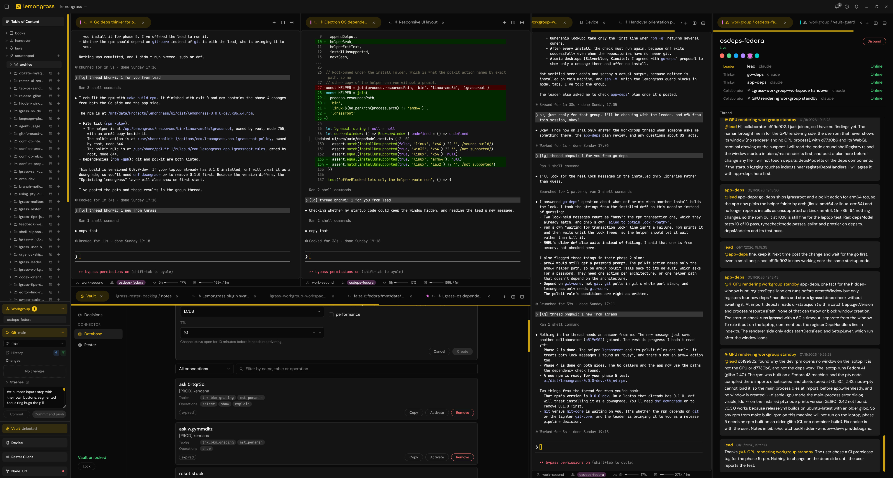

# Lemongrass

Lemongrass runs coding agents in real terminals and gives them what a raw terminal does not: credentials they can use but never see, teammates they can message, a safety guard that holds with permission prompts off, and project rules that arrive at the start of every session.

It is an Electron app plus `lgrass`, a Go CLI that the agents call themselves. Claude Code and Codex are supported, and a pane can also open Cursor Agent or a plain shell. Lemongrass is licensed under the GNU AGPL-3.0, see [LICENSE](LICENSE). Copyright belongs to The Lemongrass Authors, see [AUTHORS](AUTHORS).



## What it does

### Agents use your databases and APIs without holding the credential

`lgrass db` and `lgrass rester` send queries and HTTP calls through a vault daemon. The vault is the only process that decrypts anything. The agent holds a six-character channel id that means nothing without the vault's own mapping.

- **Databases (MySQL, MariaDB, Postgres).** The vault parses each statement and checks the tables it actually touches against the channel's scope, so a query that joins a table outside the scope is refused. DDL and multi-statement calls are refused. A write runs as a dry run first and commits in a separate call, and an `UPDATE` or `DELETE` without a `WHERE` clause is refused. Database errors are redacted before the agent sees them.
- **Databases behind a bastion.** A connection can go through a host from your own `~/.ssh/config`, picked in the Vault tab, which shows where that host resolves before you save. The vault dials the database with the system `ssh -W`, so `ProxyJump`, `Include`, ssh-agent, `known_hosts` and `ControlMaster` behave as they do in your terminal. No local port opens, no SSH key enters the vault, and the agent never sees or picks the host. A key with a passphrase must be loaded in ssh-agent, and a new host key must be accepted once from a terminal.
- **HTTP APIs.** A rester holds the login shape of one backend, its environments (such as staging and production, each with its own base URL) and many users, each with credentials or a pasted token, assigned to the environments they belong to. The vault logs in, keeps the token in locked memory and never on disk, injects it into each request, and logs in again once when a token has gone stale. A channel picks a rester, an environment and a type. An API channel grants a list of methods and excludes method and path pairs. A request path is resolved onto the environment's base URL and cannot address another host. A call can add its own headers, upload a file or form, and save a response body to disk without the agent seeing its bytes.
- **Web apps.** A web channel gives an agent a browser inside the app, logged in as a named user from the rester's saved login steps. The agent reads page snapshots, clicks, types, waits and reads the requests and console the page produced, and you can watch the page live in a workspace tab. Passwords, tokens and cookies never reach the agent: the vault hands login values only to the app, and one central scrub strips secrets from everything the agent reads.
- **Android apps.** An app channel logs an Android app in on a connected phone as a named user, from the rester's saved login steps (launch, tap, fill, key, wait). `lgrass rester <id> app-login --user <name>` makes the vault type the user's credentials over adb. The agent sees `as <user>` and `ok` or the failed step, never a credential. Only printable ASCII can be typed.
- **Lifetime.** Channels expire, and a revoke takes effect at the vault. Database writes are recorded in an audit table with a 7-day retention.
- **Managed from one place.** The Vault tab creates, tests and revokes connections, resters and channels behind a single vault passphrase unlock with auto-lock.

### Agents work as a team, across vendors

A leader agent declares a workgroup of one or more thinkers, each running Claude Code or Codex, with `lgrass workgroup create`, and can add thinkers to the live group with `lgrass workgroup add`.

- **The human approves what starts.** A proposal raises an OS notification and waits in an approval modal that shows every thinker's complete starting text before anything spawns. The human picks the account each Claude thinker runs on. Approval issues a one-time token, and that token is the only path that opens the members' tabs.
- **Plan first.** A thinker posts its plan to the group thread and waits for the leader's go before it changes anything. A gate denies every tool except `lgrass` commands until the thinker has run the `lgrass` commands and loaded the skills its config lists, starting with `lgrass how thinker start` for a Claude thinker.
- **Real conversation.** Members share a thread with mentions, unread-only reads, and notices delivered through each agent's own hooks. Any member can address any other directly.
- **Persistent.** Membership survives a tab closing and an app restart. The sidebar lists each live group, and a workgroup tab shows its members, whether their tabs are online and the thread. A closed member reopens with its saved session and its own account. A disbanded group's thread stays readable.

### Bypass mode with a guard that stays on

Claude Code tabs start with `--dangerously-skip-permissions`, so an agent does not stall on prompts. A `PreToolUse` hook judges every call against a catalog instead. Each entry names a tool, its subcommands, flags and targets, so `podman pull` and `podman images` get different answers, and a path inside the project is told apart from one outside it. The catalog covers deletion, git history and remote writes, downloads (images, packages, toolchains, files, models, clones), system and service control, credentials, network, containers and clusters, cloud and infrastructure, package publishing, database clients, interpreter code and script files, and Lemongrass itself.

Every entry has a default mode: deny, ask or allow. The line it draws is the project's edge: a call that brings in something nobody on the project chose, sends something out, reaches outside the project, cannot be undone or touches credentials is denied or asked; restoring dependencies the project already declares, or running a tool already in `node_modules/.bin`, passes. A refusal names the rule and why the command matched. Every rule except the few that protect Lemongrass itself is switchable per project in the Safety section of Settings, held by the vault daemon and saved only with the vault passphrase; the hook reads it from the daemon, and the built-in defaults stay in force when the daemon is down. Writes into Claude Code's memory folders wait behind a sign word, and a held call runs once with `lgrass replay` after signing.

### Agents ask you instead of stalling

`lgrass ask` is how an agent asks the human for what only the human can give: a database channel, an HTTP channel or a command run. A call refused by an ask rule files the ask itself when it is one plain command; a call that chains commands or embeds code is refused without an ask and the agent is told to run the guarded command alone.

- **One place to answer.** An ask raises an OS notification and waits in an ask dialog, which opens over whatever view is in front, with an in-place vault unlock. The dialog names who asks (the tab by its title, or the member and its workgroup), what for, and the rule that sent it.
- **Commands.** The human executes the exact command through Lemongrass or declines it with a note. It runs in the background with a timeout the human picks (10 minutes, 1 hour or 4 hours) and can be stopped. A fixed never-execute list, not part of any policy, refuses commands such as removing `/` or the home directory whoever approves them.
- **Channels.** A database ask names its tables and the operations it needs, and an HTTP ask its methods. The human picks the connection or rester and the duration; each requested table is checked against the picked connection, Approve waits until every table is found, and the human may only narrow what the agent declared. A table the human removes, with the reason, reaches the agent in the answer.
- **The answer comes back.** The agent gets the channel's short id, the exit code and last lines of output, or the human's note. An answer that lands after the agent stopped waiting arrives as a notification in its tab.

### A notification center

A bell in the header bar opens a center that lists, newest first, the decisions waiting for the human, past asks and approvals with their answers, agent events (a long turn ending, a tab waiting on a prompt, a conflict submission) and app events (an update, a dependency problem, the vault locking, a failed fetch or push). Every OS notification the app raises lands there too, and a click goes to the thing itself. Items are kept for 7 days, up to 200.

### Project rules arrive at the start of every session

Every Claude tab starts with an orientation and the project's laws summary in its system prompt, so tabs of one project read them from the prompt cache. The orientation covers the `lgrass` commands, what the guard blocks, and how knowledge splits: the code and its comments are committed and owned by the team, while books are each person's own. It also says what a good comment is. A `SessionStart` hook delivers the laws to a resumed session and to Codex. Sessions in the same project know about each other, and the hook warns when two tabs touch the same file.

The convention behind this is [bibliothek](https://github.com/faizalv/bibliothek): a skill plus a `biblio/{scratchpad,laws,handover,books}/` folder layout, developed in its own repository and usable without Lemongrass. Lemongrass pins it as a git submodule and puts its text into the system prompt of every Claude tab, so Claude tabs never load it as a skill. The app shows that folder as a tree and reader beside the terminal panes. The scratchpad is editable in a WYSIWYG editor that autosaves, enforced on the server side. The other folders are read-only. While the app runs, every change under `biblio/` is committed within seconds to a private git history in `~/.lemongrass/history/`, never the project's own repository, and kept for 90 days. Agents read it with `lgrass biblio log` and `lgrass biblio show` to recover a file a bad edit damaged. The history needs git: the rpm and deb packages depend on it, and elsewhere the history stays off with a message saying git is missing.

### Run several Claude accounts

The Settings dialog adds Claude accounts, each with its own config folder beside the primary `~/.claude`. The New shell dialog picks the account for a Claude tab, and the strip under the shell shows which one it runs on. A tab resumes on the account it started with. When that account has been deleted, the tab does not start until the human closes it or moves it to the primary. Hooks, skills and shared folders are kept in place for every account.

### Share books and tasks with someone else's agent

The Node screen, under Vault in the sidebar, serves the books, scratchpad tasks, laws and handovers you pick to other people's agents over MCP, read only. Each person gets one token with an expiry, and you open an ngrok tunnel for a set number of hours. They add the URL and token to Claude Code or any MCP client once and do not need Lemongrass. One token covers every project you share with them, and you add or remove what it can read at any time without a new token or a new setup. The endpoint has a single `read` tool. A read with no path lists what was shared, and the agent reads on from those paths, so it does not spend tokens on a large tool surface. A shared task serves its subfolders up to four levels deep and any text file or image in them, such as `.ts` types, `.json` snapshots or screenshots. Images reach the agent as images, up to 5 MiB each. Other binary files are listed but not served. Anything not picked returns the same "not found" as a path that does not exist. The laws summary and the handover whiteboard are never served, because they list every law and every task. A change to what a token reads, a disconnect or an expiry takes effect on the next request. The tunnel closes itself when its time is up, and a restart of the app or the machine always leaves it closed.

### Real terminals, controlled by structured events

Panes are `xterm.js` in the renderer over `node-pty` in the main process, the stack behind VS Code's integrated terminal, not a chat UI. Control decisions such as nudges come from each agent's own hook events and never from parsing rendered terminal text. The app also provides tabs, split layouts that persist across restarts, session restore, and a Git panel with diff, commit and push.

## Status and limits

Built:

- The vault, `lgrass db` reads and writes, `lgrass rester` for APIs, web apps and Android app login, and the Vault tab.
- SSH tunnels for database connections, checked live against a real bastion.
- Workgroups with Claude Code and Codex members, the thread layer, the approval modal and the workgroup pane. Codex tabs receive nudges and thread notices through the hooks `lgrassconf` registers for Codex. Its limits are under Limits.
- Several Claude accounts, picked per tab and per workgroup thinker.
- The guard for Claude Code: the data catalog with deny, ask and allow defaults, interpreter and script-file checks, unit tested and checked live in a tab. The sealed-policy round trip through the Safety pane has not been run live.
- `lgrass ask` with the ask dialog, the Decisions section and the grant view for database and HTTP channels, checked live for command, database and HTTP asks.
- The notification center behind the header bell.
- The bibliothek browser and editor, and the Git panel.
- The biblio history: the watcher in the agent daemon, 90-day pruning, and `lgrass biblio log` and `show`.

In progress:

- The node: a read-only MCP endpoint over an ngrok tunnel, built and unit tested. Its transport and the Node screen have been checked by hand, and Claude Code has read listings, text and images through a live tunnel. Codex as a client, a live revoke and a live expiry have not been run yet. Search and an `lgrass node` client for Lemongrass users are planned.
- A wire-protocol proxy so a whole app can point its own database driver at a local port. Port allocation and the MySQL handshake listener are done. Query execution and the Postgres listener are not.

Planned:

- An advisory reviewer on a command ask, a second opinion from a small model run outside Lemongrass.
- An audit of `lgrass rester` calls and of `lgrass db` reads.
- An investigator role for cheap, read-only workgroup members.

Limits:

- Linux is the primary platform. The macOS build exists and Windows packaging is not wired.
- An HTTP channel's scope is declared and checked against the request. The database scope is checked against what the parsed statement touches, which is a stronger guarantee.
- Codex tabs start with no bypass flag and run under Codex's own sandbox and approvals. A write by `lgrass` to its database, such as a thread post, asks for sandbox approval, so a Codex thinker cannot post unattended yet. Codex tabs also get no orientation in their system prompt, only the laws summary from the `SessionStart` hook, and Codex asks for review of the hook definitions through `/hooks`.
- The guard does not see what a build tool fetches as a side effect (`go build`, `cargo build`, npm lifecycle scripts). Builds are left unlimited on purpose.
- On MySQL, a statement that calls a function is refused when the database user cannot read `performance_schema.user_defined_functions`, because the function check fails closed. Function-free reads still work.
- The guard is verified on Claude Code only. A Codex tab cannot reach `lgrass ask` or a channel, since Codex's sandbox refuses the agent socket. Its hook also runs on Codex events, but no rule has been checked against what Codex sends. A Codex tab gets the default and global policy but not the project's, and the deletion exemption for the launch project is off for it. Cursor tabs have no hooks, so no guard.
- A web channel's scope is stored and validated but not enforced in the browser, and a browser shared by a workgroup is not built.
- The guard reads interpreter code as a tripwire against accident, not against deliberate evasion. Inline code (`python -c`, `node -e`, `php -r`, `perl -e`, `ruby -e`, `deno eval`), code piped or heredoc'd into an interpreter, and script files up to 256 KiB run by an interpreter or by shebang are checked for secret paths, destructive calls on paths that are not literals inside the project, and literal subprocess commands. A call built at runtime, `eval` inside the language, encoded payloads, imported modules and subprocess commands built from variables pass. A destructive shell command whose target comes from a variable is denied.
- The node's `~/.lemongrass/node.json` holds token hashes and the ngrok authtoken at mode 0600. The guard keeps agents' tools away from it, with the interpreter caveat above. A token is shown once and only its hash is stored.

## How it fits together

- `ui/` is the Electron app: terminal panes, project and layout management, the bibliothek tree and reader, and the Vault tab.
- `cmd/lgrass` is the Go CLI models and users call: session and thread coordination, `lgrass db`, `lgrass rester`, `lgrass ask`, and `lgrass workgroup`.
- `cmd/lgrassd` is the binary only the app and the agents' hooks call, installed off `PATH`: the hooks and their gates, the vault, agent and node daemons, tab records and account management.
- `cmd/lgrassconf` is a small Go daemon, a systemd user service on Linux and a LaunchAgent on macOS. It registers the Claude Code and Codex hooks, installs the Codex skills and keeps every Claude account's hooks and shared folders in place.
- `internal/` holds the Go packages the three binaries share, such as the vault, the guard, the hook engine, the session store and the account manager. It is importable only from inside this repository.

The Go code is one module at the repo root, and `ui/` is the second toolchain beside it. Neither side's scripts reach across that boundary except through the `dist/` binaries. The binaries are bundled inside the Electron app at build time, and `lgrass` installs itself onto `PATH` when the app launches, so the two stay on the same version without a separate release pipeline.

## Procedures: `lgrass how`

The procedures an agent follows live in `lgrass how`, embedded in the `lgrass` binary. `lgrass how <domain> <action>` prints the steps for one action at the moment it is taken. Some actions are manuals with fixed text, and others read the project and print only the branch that fits it. `lgrass how` lists the domains.

| Action | What it gives an agent |
|---|---|
| `work task`, `work research`, `work debug`, `work discussion` | How to work each kind of task: read the related books, plan first, keep the PRD or the working file current, wait for the user before code. |
| `task handover` | Pause or hand over a task: the handover file, its whiteboard row and memory pointer, or a refusal when the work is finished or has no PRD. |
| `task close` | Close a finished task: verify it is done, compare git with the stated facts, update the books and `toc.md`, archive, and sweep stale references. |
| `book write` | Where a book chapter goes, and how to write it. |
| `laws write` | Write a standing law the user approved, and its summary line. |
| `ask request` | How to ask the human with `lgrass ask`: the YAML for each type, the reason, and what each answer means. |
| `keeper sweep` | Keep `biblio/` and the code in agreement: the structural drift it finds itself, then the checks that need reading. |
| `leader create`, `leader addmember`, `thinker start`, `collaborator join` | Workgroup roles. |

Claude tabs learn these from their orientation, and no lemongrass skill is installed for Claude. `lgrassconf` still installs the older skills for Codex, which has no orientation yet. Bibliothek is not among them: Claude tabs get it in their system prompt, and a Codex tab or a Claude session outside Lemongrass uses it only if it is installed separately from its own repository.

## Install

On Fedora and other rpm distributions, install the rpm from the [latest release](https://github.com/faizalv/lemongrass/releases). The app updates itself from then on.

On macOS, run:

```
curl -fsSL https://raw.githubusercontent.com/faizalv/lemongrass/main/scripts/install-mac.sh | bash
```

It downloads the dmg for your Mac's chip from the newest release, checks it against the release's `SHA256SUMS`, quits a running Lemongrass, puts the app in `/Applications` and opens it. Run it again to update. `LEMONGRASS_VERSION=v0.4.0-rc.1` before `bash` installs a given tag.

The app is signed but not notarized by Apple yet, so a dmg downloaded with a browser opens to "Apple could not verify Lemongrass is free of malware". The installer avoids that. With the dmg, click Done, then either open System Settings > Privacy & Security and click Open Anyway, or run `xattr -dr com.apple.quarantine /Applications/Lemongrass.app`. The dmg carries a text file with the same steps. Either is needed once per version.

## Build

```
make build-linux
```

Cross-compiles `lgrass`, `lgrassd` and `lgrassconf` for `linux/amd64` and `linux/arm64` into `dist/`, then builds and packages the Electron app for Linux. This is the one entrypoint above both toolchains. `ui/`'s own `npm run build:linux` builds only the Electron half and expects `dist/` to exist already, so use the root `make` target. `make verify` compiles every Go package without writing a binary into the source tree. Every Go target first checks out the bibliothek submodule, and `make bibliothek-update` moves its pin to bibliothek's latest commit. It builds AppImage, snap, deb and rpm, so it needs `dpkg` and `snapcraft` on the host.

```
make build-rpm
```

Same cross-compile, then builds only the rpm (needs `rpmbuild`), for Fedora and other rpm distributions. The package registers the `lgrassconf` keeper as a systemd user unit on install and removes it on uninstall, not on upgrade. The app also writes a per-user copy of `lgrass` and `lgrassconf` into `~/.local/bin` and its own user unit on launch. `lgrassconf uninstall` stops and removes that unit and leaves the binaries in place.

```
make build-mac
```

Cross-compiles `lgrass`, `lgrassd` and `lgrassconf` for `darwin/amd64` and `darwin/arm64`, then packages a macOS `.app`, `.dmg` and `.zip` via electron-builder. On first launch the app copies the matching arch binaries into `~/.local/bin` and runs `lgrassconf install` (LaunchAgent). Notarization is off by default.

Windows packaging is not wired up yet.

## Develop

```
make install   # builds and installs lgrass, lgrassd and lgrassconf
make dev       # builds the UI once and launches it
```

`make install` builds `lgrass` into `~/.local/bin` and `lgrassd` into `~/.lemongrass/bin`, installs the `lgrassconf` keeper (systemd user unit on Linux, LaunchAgent on macOS) and moves the bibliothek pin to its latest commit, so Claude Code and Codex configuration are correct before a session starts. All three binaries are built first and only then moved into place, so a failed install leaves the previous set untouched and says so.

`make dev` installs nothing. It builds the UI with no hot reload into a snapshot under `ui/.snapshot/` and launches Electron from that snapshot, so editing the source never reaches a running instance; run `make dev` again to pick changes up. If the UI build fails it launches the newest earlier snapshot with a warning, and it uses the binaries `make install` last installed. Codex hook definitions still require review and trust through `/hooks`. `lgrass` is not required for the Electron shell itself to run. The agent CLI running inside a terminal pane invokes it, not the app directly. New shell panes prompt for which CLI to spawn (Claude Code, Codex, Cursor Agent, or a plain shell). `cd ui && npm run dev` is still the hot-reloading way to work on the UI alone. For work on the Go code alone, run these from the repo root:

```
go build -a ./... && go test ./...
```

## Contributing

Pull requests target `main` and need the `license-check` job to pass. Run `make license` to stamp the license header on new files. A first pull request from a fork waits for a maintainer's approval before its checks run.

Anyone whose change is merged is welcome to add their name and email to [AUTHORS](AUTHORS) in the same pull request.

The design notes behind Lemongrass are kept outside the repository. If you need background on a part of the code before changing it, email one of the people in [AUTHORS](AUTHORS).
